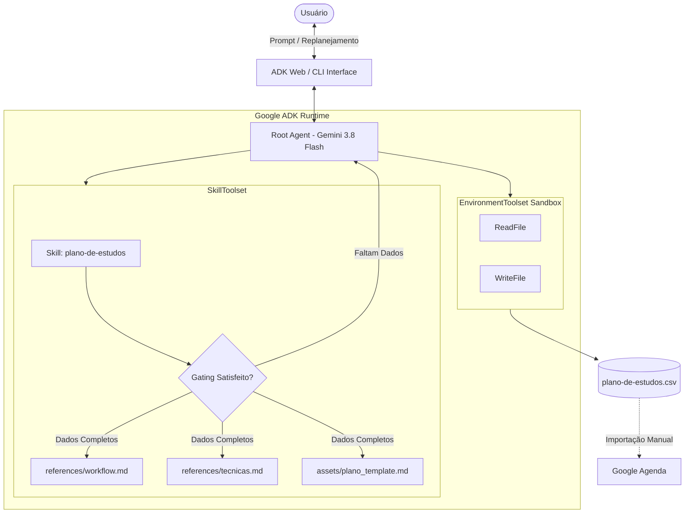

# 🧠 Study Agent — Autonomous AI Study Planner

> **Agente autônomo de mentoria e cronogramas de estudo construído com Google ADK (Agent Development Kit) e Google Gemini.**

[](https://www.python.org/)
[](https://adk.dev/)
[](https://aistudio.google.com/)
[](LICENSE)

---

## 📌 Visão Geral

O **Study Agent** é um agente inteligente projetado para transformar objetivos de aprendizado em **planos de estudo executáveis, realistas e integrados à rotina**. 

Diferente de prompts genéricos de IA, o agente opera sob uma arquitetura determinística de **Skills com Divulgação Progressiva** e **Gating Rules**, garantindo que nenhum cronograma seja produzido sem diagnóstico prévio das restrições reais do estudante (disponibilidade, prazo, objetivo e nível atual).

Além de estruturar módulos com revisão espaçada e autoavaliação, o agente interage com o sistema de arquivos via **EnvironmentToolset** para gerar automaticamente uma agenda em formato **CSV**, pronta para importação direta no **Google Agenda**.

---

## ⚡ Principais Funcionalidades

- **Regra Rígida de Gating:** Não gera planos sem coletar: Objetivo claro, Data de início/fim, Janela diária de horários e Nível técnico atual.
- **Divulgação Progressiva de Conhecimento (ADK Skills):**
  - **Nível 1 (Descoberta):** Metadados e gatilho da skill.
  - **Nível 2 (Regra de Negócio):** Validação de pré-requisitos antes de carregar instruções profundas.
  - **Nível 3 (Execução Sob Demanda):** Carregamento de frameworks metodológicos (Feynman, Active Recall, Revisão Espaçada) e templates apenas quando necessário.
- **Exportação Direta para o Google Agenda:** Geração de arquivo `plano-de-estudos.csv` com formatação compatível de eventos, horários e lembretes.
- **Capacidade de Replanejamento:** Quando sessões são perdidas, o agente lê o arquivo existente via ferramenta `ReadFile`, reequilibra a carga cognitiva e sobrescreve via `WriteFile` sem acumular conteúdo em um único dia.
- **Execução Segura em Sandbox:** I/O de arquivos isolado, expondo apenas ferramentas estritas de leitura e escrita (`ReadFile`, `WriteFile`), sem acesso a shell arbitrário.

---

## 🏗️ Arquitetura do Sistema



---

## 📁 Estrutura do Repositório

```text
├── AGENTS.md                          # Especificação técnica do agente e regras de engenharia
├── README.md                          # Documentação oficial do projeto
└── skills/
    └── plano-de-estudos/              # ADK Skill modular
        ├── SKILL.md                   # Ponto de entrada da skill e regras de gating
        ├── assets/
        │   ├── exemplo_plano.md       # Exemplo de saída esperada
        │   └── plano_template.md      # Template estruturado do plano
        └── references/
            ├── salvar_agenda.md       # Especificação do formato de CSV para Google Agenda
            ├── tecnicas.md            # Heurísticas de aprendizagem (Feynman, Pomodoro, Revisão Espaçada)
            └── workflow.md            # Máquina de estados de execução do agente
```

---

## 🚀 Como Executar

### Pré-requisitos

- **Python 3.10+**
- Gerenciador de pacotes [`uv`](https://astral.sh/uv) instalado
- Chave de API do [Google AI Studio](https://aistudio.google.com/apikey)

### 1. Clonar o Repositório

```bash
git clone https://github.com/diogold01/agentsdk.git
cd agentsdk
```

### 2. Configurar Variáveis de Ambiente

Crie o arquivo `.env` na raiz do projeto ou dentro do módulo do agente:

```env
GOOGLE_GENAI_USE_VERTEXAI=FALSE
GEMINI_API_KEY=sua_chave_do_google_ai_studio_aqui
MODEL=gemini-3.8-flash
```

### 3. Instalar Dependências

Utilizando o `uv`:

```bash
uv sync
```

### 4. Iniciar a Interface ADK Web

```bash
uv run adk web
```

Acesse no navegador: `http://localhost:8000`.

---

## 💬 Exemplo de Uso

### 1. Diagnóstico e Gating

> **Usuário:**  
> *"Quero aprender JavaScript para fazer meu primeiro projeto web."*

> **Study Agent:**  
> *"Excelente objetivo! Para montar um cronograma realista e sob medida para a sua rotina, preciso saber:*  
> 1. *Qual a sua data de início e a data-alvo final?*  
> 2. *Quais dias da semana e quantas horas por dia você pode se dedicar?*  
> 3. *Qual é o seu nível atual? (Já teve contato com HTML/CSS ou lógica de programação?)"*

---

### 2. Entrega do Cronograma e Geração de Arquivo

Assim que os 4 pilares são respondidos, o agente:
1. Divide o aprendizado em **módulos progressivos** com entregáveis práticos.
2. Insere sessões dedicadas de **Revisão Espaçada** e **Checkpoints de Autoavaliação**.
3. Aciona a ferramenta `WriteFile` para gravar o arquivo `plano-de-estudos.csv`.

---

## 📅 Como Importar o CSV no Google Agenda

1. Acesse o [Google Agenda](https://calendar.google.com/) no seu navegador.
2. No canto superior direito, clique na engrenagem de **Configurações** ⚙️ → **Configurações**.
3. No menu lateral esquerdo, selecione **Importar e exportar**.
4. Faça o upload do arquivo `plano-de-estudos.csv` e selecione a agenda desejada.
5. Pronto! Todas as sessões, horários de início/fim e descrições detalhadas estarão no seu calendário.

---

## 🛠️ Tecnologias Utilizadas

- **[Google ADK (Agent Development Kit)](https://adk.dev/):** Framework para orquestração de agentes e toolsets.
- **[Google Gemini](https://ai.google.dev/):** Modelo fundacional `gemini-3.8-flash` de alta velocidade e precisão analítica.
- **[Antigravity CLI (`agy`)](https://antigravity.google/):** Ambiente de desenvolvimento e testes assistido por IA.
- **[Astral uv](https://astral.sh/uv):** Gerenciador de projetos e ambientes virtuais ultrarrápido em Rust.

---

## 📄 Licença

Distribuído sob a licença MIT. Consulte `LICENSE` para mais informações.
